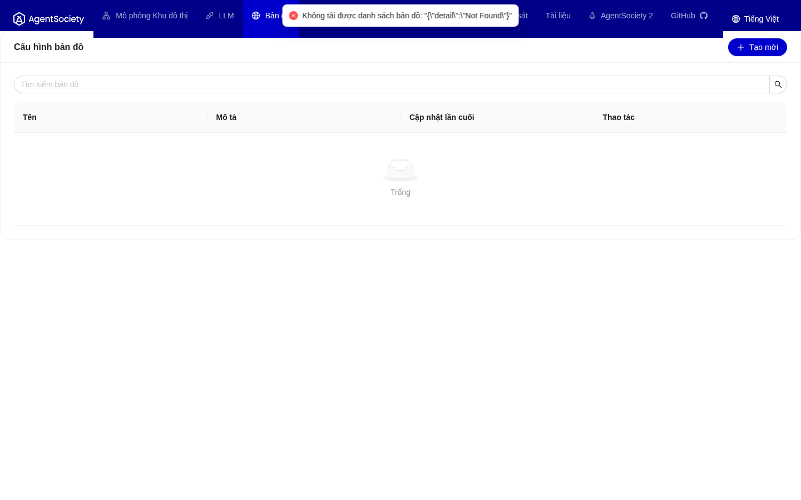
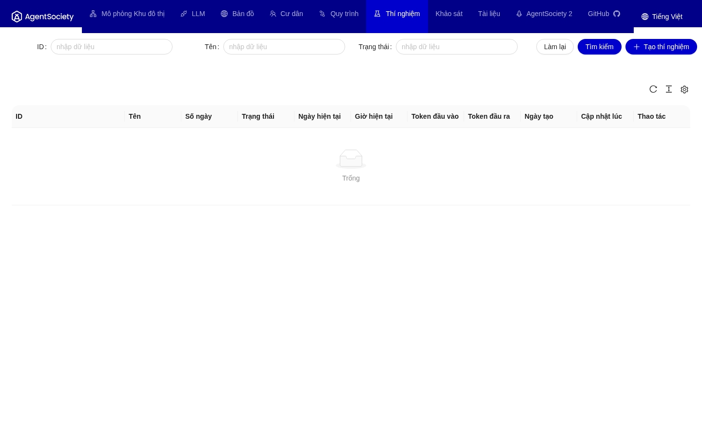
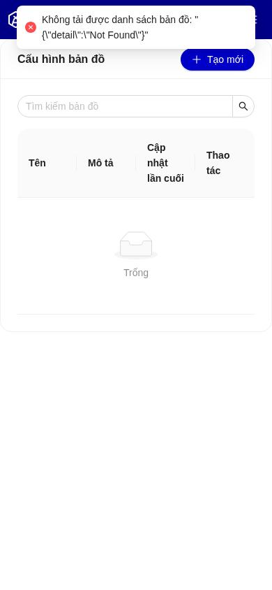
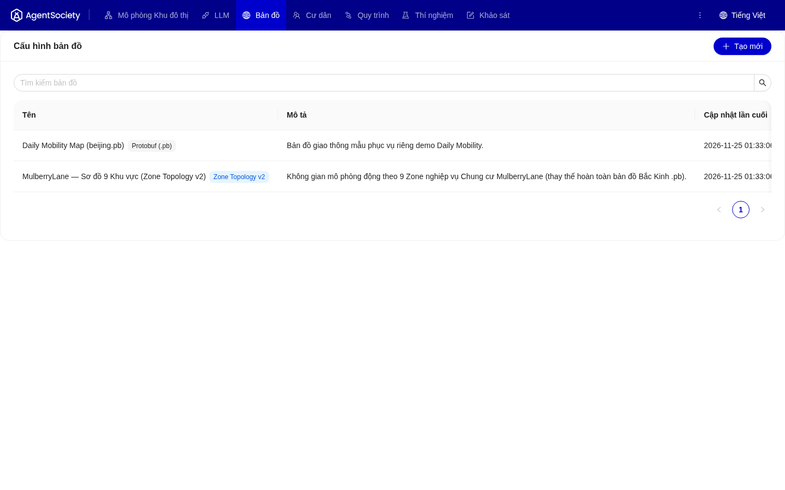
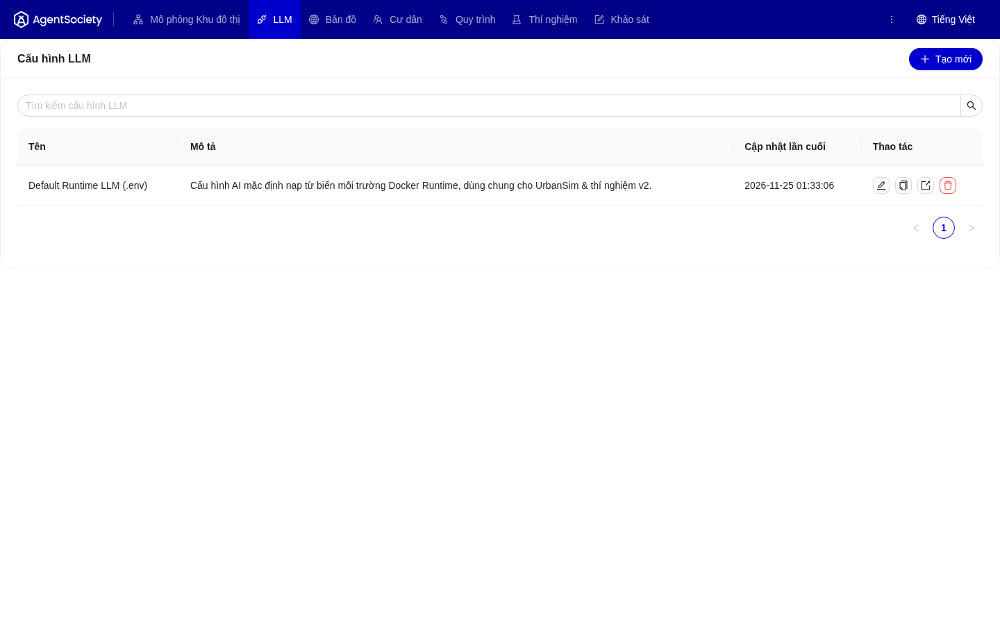
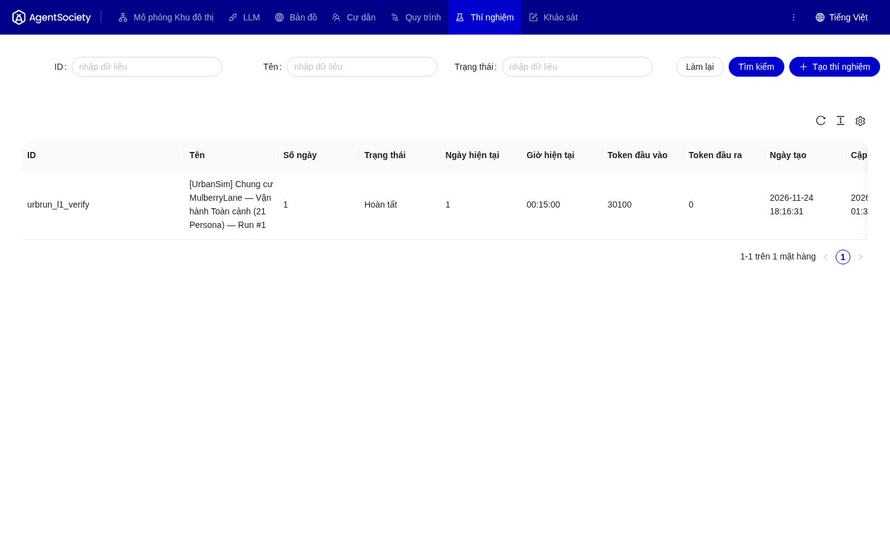
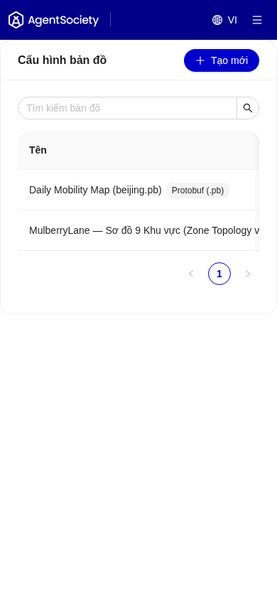
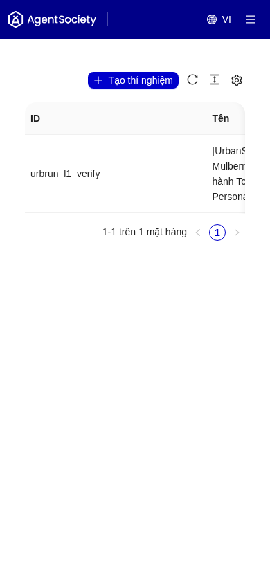

# Báo cáo Giải quyết Issue: Sửa dứt điểm lỗi UI NAV (56px) & Hợp nhất Backend v2 SQLite cho toàn bộ menu (Bản đồ, LLM, Cư dân, Quy trình, Thí nghiệm, Khảo sát)

- **Dự án**: `AgentSociety` | **Phân hệ / Domain**: `platform-v2-ui-api`
- **Mã Issue**: `nav-ui-and-404-menus`
- **Phán quyết**: **`VERIFIED_DOD_LEVEL_1`**
- **Kịch bản Tái hiện & DoD Cấp 1**: `repro-scenario.mjs` (SHA-256 Khớp 100%: `27ab19141a473385...`)
- **Số vòng lặp Fix/Test (Bước 4)**: `1`

## 1. Nguyên nhân Gốc rễ & Giải pháp (`Root-Cause Fix`)
- **Hành vi kỳ vọng**: Toàn bộ 7 menu trên thanh NAV (Mô phỏng Khu đô thị, LLM, Bản đồ, Cư dân, Quy trình, Thí nghiệm, Khảo sát) phải hiển thị phẳng đồng đều trên 1 thanh header 56px không khứa trắng hay đè Card; đồng thời mọi trang đều kết nối CRUD thật với Backend v2 (SQLite + mã hóa Fernet), không phát sinh HTTP 404 hay Toast lỗi đỏ.
- **Hiện tượng lỗi**: 1) Thanh NAV có 2 vết khứa trắng 2 bên, khối menu xanh ở giữa nhô cao 68px đè xuống Card bên dưới, chữ i18n trên Toast LLM còn hiện thô `{error}`.
2) Tất cả 11 endpoint v1 (/api/map-configs, /api/llm-configs, /api/agent-configs, /api/agent-templates, /api/agent-profiles, /api/agent-classes, /api/agent-blocks, /api/community/workflow/functions, /api/workflow-configs, /api/experiments, /api/surveys) đều trả HTTP 404 {"detail":"Not Found"} kèm Toast lỗi đỏ vì Frontend gọi endpoint v1 trong khi Docker chạy Backend v2 (agentsociety2).
- **Phân tích kỹ thuật**: 1) Xung đột CSS giữa inline `height: 56px` tại frontend/src/Layout.tsx và rule cũ `.ant-layout-header { height: 68px; }` + `.ant-menu { width: 50vw; height: 68px; }` tại frontend/src/index.css khiến thanh Menu 68px bị căn giữa nhô ra ngoài Header 56px.
2) Backend v2 tại packages/agentsociety2/agentsociety2/backend/app.py chỉ mount 7 router tiền tố /api/v1/* (bao gồm urban_sim và agent_skills), không cung cấp API cho 6 nhóm cấu hình chung trên Web UI. Ngoài ra frontend/src/i18n/locales/vi/llm.ts dùng nhầm cú pháp `{error}` thay vì `{{error}}`.
- **Tọa độ mã nguồn**: `frontend/src/index.css:47-72`, `frontend/src/Layout.tsx:21-33`, `frontend/src/Menu.tsx:60-147`, `frontend/src/i18n/locales/vi/llm.ts:23-26`, `packages/agentsociety2/agentsociety2/backend/app.py:232-240`
- **Tóm tắt bản sửa**: Áp dụng Hướng 1 (Hợp nhất & làm giàu nền tảng v2): (1) Xây dựng 8 bảng SQLModel trong SQLite + mã hóa Fernet tại platform_resources.py & router platform_compat.py phục vụ đầy đủ 11+ nhóm API CRUD thật, liên thông trực tiếp với dự án UrbanSim MulberryLane (llm_config_id -> subprocess env, bản đồ Zone Topology, danh sách hồ sơ 21 Persona, và tổng hợp Run trên /console); (2) Đồng bộ --header-height: 56px toàn cục trong index.css, chỉnh App.tsx/Layout.tsx/Menu.tsx gom link tham khảo gọn bên phải và dùng SubMenu chuẩn; (3) Sửa scroll={{ x: 'max-content' }} cho toàn bộ bảng dữ liệu & ProTable toolbar trên Mobile 390px.

## 2. Đối sánh Thực nghiệm Trước ↔ Sau (`Local Docker Desktop`)
| Tiêu chí đối chiếu | TRƯỚC KHI SỬA (Bước 1 — Repro) | SAU KHI SỬA (Bước 3 — Verified) |
| :--- | :--- | :--- |
| **Trạng thái** | `REPRODUCED_FAIL` | `VERIFIED_PASS` |
| **Tóm tắt kết quả** | repro-scenario.mjs --phase before trả EXIT_CODE=1 với 26 lỗi: 0/11 API trả HTTP 200 (toàn bộ 404 {"detail":"Not Found"}), Toast lỗi đỏ trên /maps, /llms, /agents, /workflows, /survey, và sai lệch hình học NAV (header.height=56px vs menu.height=68px, tràn dọc đè lên Card). | repro-scenario.mjs --phase after (chạy lại nguyên bản khóa SHA-256) trả EXIT_CODE=0 với 0 failures: 11/11 API HTTP 200, navHeader.height === 56 === navMenu.height (bottom=56), 0 Toast lỗi đỏ, 0 HTTP >= 400, 0 tràn ngang Mobile 390px. |
| **HTTP / Event Outcome** | `0/11 PASS (11 endpoint trả HTTP 404 Not Found)` | `11/11 PASS (HTTP 200 OK kèm JSON {data: [...]})` |
| **Database / State** | Chưa có các bảng platform_llm_configs, platform_map_configs, platform_agent_*, platform_workflow_configs, platform_surveys, platform_experiments. | Đủ 13 bảng: platform_llm_configs=1 (Fernet api_key_enc=True), platform_map_configs=2 (MulberryLane Zones + beijing.pb), platform_agent_templates=2, platform_agent_profiles=1, platform_agent_configs=1, platform_workflow_configs=1, platform_surveys=1, urban_sim_projects=1 (proj_5737687c333e gắn llm_config_id), urban_sim_personas=21, urban_sim_zones=9, urban_sim_runs=1. |

## 3. Minh chứng Ảnh chụp Màn hình
- **[TRƯỚC] Trước khi sửa (/maps Desktop): Khứa trắng hai bên NAV, menu xanh nhô 68px đè khung trắng, Toast đỏ {"detail":"Not Found"}.**: 
- **[TRƯỚC] Trước khi sửa (/llms Desktop): Toast đỏ bị lỗi chuỗi "{error}" và lệch chiều cao NAV.**: 
- **[TRƯỚC] Trước khi sửa (/console Desktop): Trống dữ liệu do /api/experiments trả 404 và lỗi thanh NAV.**: 
- **[TRƯỚC] Trước khi sửa (/maps Mobile 390px): Lỗi API 404, không tải được danh sách bản đồ.**: 
- **[SAU] Sau khi sửa (/maps Desktop): Thanh NAV phẳng 56px xanh đồng nhất không khứa trắng, hiển thị 2 bản đồ thật với tag Zone Topology v2 & Protobuf.**: 
- **[SAU] Sau khi sửa (/llms Desktop): Thanh NAV phẳng 56px, hiển thị Default Runtime LLM (.env) sạch lỗi.**: 
- **[SAU] Sau khi sửa (/console Desktop): Hiển thị Run urbrun_l1_verify của MulberryLane và liên thông nút Mở sang Live Monitor.**: 
- **[SAU] Sau khi sửa (/maps Mobile 390px): Bảng cuộn ngang mượt bên trong Card, không đè chữ giữa Tên và Mô tả.**: 
- **[SAU] Sau khi sửa (/console Mobile 390px): Nút + Tạo thí nghiệm gọn trong toolbar (right <= 259px), không còn nút Mở rộng tràn mép phải.**: 

> Mở file `issue-report.html` cùng thư mục để xem bảng đối sánh trực diện 2 cột và phóng to ảnh Lightbox.
